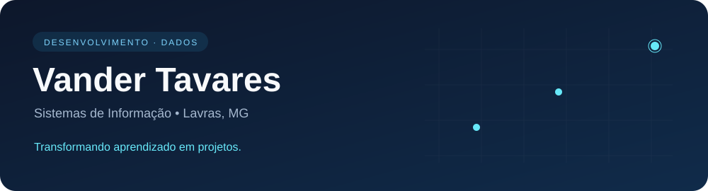

  

## Olá! Sou o Vander 👋

Estudante de **Sistemas de Informação na Fagammon**, com experiência em desenvolvimento Full Stack e suporte de TI. Atualmente, estou direcionando meus estudos para **Análise de Dados**, com foco em SQL e PostgreSQL.

- 💻 Atuei em projetos com Java, Spring Boot, JavaScript, React, Vue e PostgreSQL na **YouX Group**.
- 🌟 Fui reconhecido como **destaque do YouX Lab** durante meu estágio.
- 🏆 Desenvolvi todo o sistema do projeto vencedor do **Bootcamp da Fagammon**, em parceria com a **Jeito Caseiro**.
- 🎯 Busco oportunidades de **estágio em dados**: remoto ou presencial em Lavras–MG.

## Tecnologias com que já trabalhei

  
  
  
  
  
  
  
  

**Foco de estudo:** SQL e PostgreSQL. Próximas etapas: Excel, Power BI e Python aplicados à análise de dados.

## Projeto em destaque

### [TrackingFood 🍞](https://github.com/VanderTavares7/TrackingFood)

**1º lugar no Bootcamp da Fagammon, em parceria com a Jeito Caseiro.** Aplicação para consultar fichas técnicas de alimentos, com vídeos, temporizador de fermentação e o **Modo Mãos Sujas**, que permite controlar funcionalidades por voz. Desenvolvi todo o sistema em HTML, CSS e JavaScript.

---

  <a href="https://github.com/VanderTavares7?tab=repositories">Explore meus projetos ↗</a>

